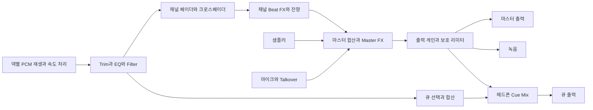

# DJ 컨트롤러 웹게임 기획서

버전 v0.1 · 작성일 2026년 10월 29일 · 단계 기획 · 가칭 MIXROOM

**MIXROOM은 시판 DJ 컨트롤러의 조작과 소리 변화를 웹에서 경험하고, 두 곡을 연결해 나만의 공연을 만드는 DJ 시뮬레이션 게임이다.** 조그휠, 페이더, EQ, 큐, 루프, 이펙트가 실제 재생 음원에 작동하며, 연습 과제와 공연 미션으로 사용법을 익힌다.

정식 목표는 **4덱과 4채널 믹서, 스크래치, 퍼포먼스 패드, 스템 제어, 녹음, 호환 MIDI 컨트롤러 연결**이다. 첫 플레이 가능 버전에서는 2덱의 실제 믹싱을 완성한다. 이후 같은 오디오 엔진을 확장한다. 아래 범위와 수치는 구현 및 플레이 테스트를 위한 제안이며, 기능별 출시 단계와 통과 기준을 함께 정의한다.

## 1 제품의 방향

| 항목 | 기획 방향 |
| --- | --- |
| 장르 | DJ 장비 시뮬레이션과 음악 공연 게임 |
| 주요 사용자 | 장비 없이 DJ를 체험하려는 입문자, 믹싱과 스크래치를 연습하려는 사용자 |
| 핵심 재미 | 박자를 맞추고 저음을 교대하며 두 곡이 하나의 흐름으로 이어지는 순간 |
| 기본 플랫폼 | PC 웹브라우저, 키보드와 마우스 |
| 확장 플랫폼 | 태블릿 멀티터치, 호환 MIDI 컨트롤러 |
| 언어 | 한국어 설명과 실제 장비에서 사용하는 영문 기능명 병기 |
| 플레이 시간 | 튜토리얼 1~3분, 미션 3~5분, 자유 연주 시간 제한 없음 |
| 화면 방향 | 좌우 덱과 중앙 믹서가 한 화면에 보이는 장비 중심 화면 |
| 저장 | 브라우저에 설정, 곡 분석, 큐, 개인 기록 저장 |
| 배포 구상 | 현재 저장소의 dj-controller 폴더를 사용하는 독립 정적 웹게임 |

음악 기능은 자유 연주에서 처음부터 사용할 수 있다. 진행 보상은 새로운 미션, 공연장 연출, 외관으로 구성한다. 기본 조작을 잠금 해제하기 위해 반복 플레이를 요구하지 않는다.

## 2 실제 장비를 참고하는 기준

컨트롤러와 연결된 DJ 소프트웨어를 함께 참고한다. 곡 분석, 파형 표시, 스템 분리처럼 소프트웨어가 담당하는 기능도 게임에 포함하되, 특정 제품 전체를 그대로 복제한다고 표현하지 않는다. 화면과 소리 처리 방식은 MIXROOM의 독자적인 설계로 만든다.

| 참고 제품 | 공식 자료에서 확인한 특징 | 게임에 반영할 방향 |
| --- | --- | --- |
| Pioneer DJ DDJ-FLX4 | 2채널 구성, Smart Fader, Smart CFX | 입문자가 이해하기 쉬운 기본 배치와 선택 가능한 믹싱 보조 기능. [공식 제품 안내](https://www.pioneerdj.com/en/product/dj-controllers/ddj-flx4/) |
| Pioneer DJ DDJ-FLX10 | 4채널 구성, 보컬·드럼·악기 제어, 파트별 FX, Mix Point Link | 4덱 확장, 스템별 조작, 전환 지점을 연결하는 예약 재생. [공식 제품 안내](https://www.pioneerdj.com/en/product/dj-controllers/ddj-flx10/) |
| RANE PERFORMER | 모터 구동 플래터, 스템 분할, 크로스페이더 곡선과 리버스 조절 | 스크래치 응답과 커팅 설정, 스템을 다른 채널로 보내는 작업 흐름. [공식 FAQ](https://support.rane.com/en/support/solutions/articles/69000851441-rane-performer-frequently-asked-questions) |

여기서 4덱은 동시에 독립 재생하는 곡 네 개, 4채널은 그 소리를 조절하는 믹서 입력 네 개를 뜻한다. 물리 조그휠의 무게, 모터 토크, 노브의 저항감은 화면만으로 재현할 수 없으므로 가상 관성 및 감도 설정으로 조작감을 조정한다.

## 3 전체 플레이 흐름

1. **입장과 오디오 준비:** 사용자가 시작을 누르면 소리를 활성화한다. 출력 장치, 음량, 조작 방법을 확인한다.
2. **모드 선택:** DJ 아카데미, 자유 연주, 클럽 미션 중 하나를 선택한다.
3. **곡 준비:** 라이브러리에서 A와 B 덱에 곡을 올리고 BPM, 파형, 큐 위치를 확인한다.
4. **첫 곡 재생:** A를 재생하고 B를 미리 들으며 시작 위치와 빠르기를 준비한다.
5. **믹싱:** 박자를 맞춘 뒤 채널 페이더, EQ, 크로스페이더로 B를 자연스럽게 섞는다.
6. **공연 확장:** 루프, 핫큐, 샘플, FX를 사용하고 다음 곡을 준비한다.
7. **결과 확인:** 미션에서는 전환별 피드백을 받고, 자유 연주에서는 녹음과 세션을 저장한다.

첫 체험은 준비된 두 곡으로 시작한다. 1분 안에 재생, 크로스페이더 이동, 필터 조절을 경험하고, 이어서 직접 박자를 맞추는 과정으로 넘어간다. 보조 기능이 개입하면 무엇을 바꿨는지 표시한다.

## 4 기능 범위와 출시 단계

**1차**는 실제 믹싱이 가능한 첫 버전, **2차**는 정식 기능 확장, **연구**는 기술 검증 후 제공 여부를 결정하는 기능이다. **조건부**는 브라우저나 연결 장치가 지원해야 사용할 수 있다는 뜻이다. 아직 구현되지 않은 기능은 작동하는 버튼처럼 제시하지 않는다.

### 덱과 재생

| 기능 | 요구 동작 | 단계 |
| --- | --- | --- |
| 독립 덱 | A와 B의 곡, 재생 위치, 템포, 큐, 루프를 각각 관리 | 1차 |
| 4덱 전환 | 왼쪽 A/C, 오른쪽 B/D 전환. 네 곡의 재생과 믹서는 계속 유지 | 2차 |
| Play와 Pause | 현재 위치에서 시작하거나 일시 정지 | 1차 |
| Cue | 기준점 설정, 재생 중 기준점 복귀, 누르는 동안 미리 재생 | 1차 |
| Hot Cue | 덱마다 8개 지점을 저장하고 즉시 이동. 색과 이름, 삭제 지원 | 1차 |
| 템포 페이더 | 기본 ±8%, 선택 ±16%와 ±50%, 원속도 복귀 | 1차 |
| Tempo Sync와 Beat Sync | BPM만 맞추기와 박자 위치까지 맞추기를 분리. 기준 덱 표시 | 1차 |
| Master Tempo | 속도를 바꿔도 음높이 유지. 별도 타임 스트레치 처리 | 1차 |
| Key Shift | 템포를 유지한 채 반음 단위 조성 변경, 원래 키 복귀 | 2차 |
| 조그휠 | 윗면 스크래치, 테두리 피치 벤드, 정지 중 위치 탐색 | 1차 |
| Vinyl 모드 | 윗면 접촉 시 재생을 붙잡는 동작 켜기와 끄기 | 1차 |
| Slip 모드 | 조작 중에도 원래 진행 위치를 계산하고 조작 종료 시 복귀 | 2차 |
| Reverse와 Brake | 역재생, 시작과 정지의 가속 및 감속 시간 조정 | 2차 |
| Beat Jump | 설정한 박자 수만큼 앞뒤 이동, 기본 1·2·4·8·16·32박 | 1차 |
| Quantize | 지원하는 큐와 루프 동작을 선택한 박자 격자에 맞춤 | 1차 |
| 파형과 비트그리드 | 전체 파형, 확대 파형, 다운비트, 프레이즈, 경과 및 남은 시간 | 1차 |
| 그리드 편집 | BPM 직접 입력, 절반과 두 배, 첫 박 위치 이동 | 1차 |
| 가변 템포 그리드 | 곡 중간마다 BPM이 달라지는 곡에 여러 기준점 설정 | 2차 |
| Instant Doubles | 다른 덱에 같은 곡과 현재 위치를 복제 | 2차 |
| 전환 지점 연결 | 지정한 음악 구간에서 다음 덱이 시작되도록 예약 | 2차 |

### 믹서와 모니터링

| 기능 | 요구 동작 | 단계 |
| --- | --- | --- |
| Trim과 채널 페이더 | 입력 게인과 공연 음량을 분리 | 1차 |
| 3밴드 EQ | HIGH·MID·LOW 각각 조절, 중앙 0dB. 기본 범위 -26~+6dB | 1차 |
| EQ Kill | 선택한 대역을 제거하는 아이솔레이터 모드 | 2차 |
| Filter | 중앙 중립, 왼쪽 저역통과, 오른쪽 고역통과 | 1차 |
| Crossfader | A/B 전환, Equal Power와 커팅 곡선, 리버스 | 1차 |
| Crossfader Assign | 각 채널을 왼쪽, 오른쪽, 미할당으로 지정 | 2차 |
| Master와 미터 | 마스터 음량, 채널별 레벨, 마스터 레벨, 클리핑 표시 | 1차 |
| Headphone Cue | 선택 채널을 채널 페이더 앞에서 별도 미리 듣기 | 1차 |
| Cue Mix와 Cue Level | 헤드폰에서 미리 듣기와 마스터의 비율 및 전체 음량 조절 | 1차 |
| Split Cue | 한 출력의 좌우에 모노 큐와 모노 마스터를 분리 | 1차 |
| 별도 헤드폰 출력 | 마스터와 큐를 서로 다른 출력 경로로 전송 | 2차 조건부 |
| Booth | 별도 부스 모니터 버스와 음량 조절 | 2차 조건부 |
| 마이크 | 장치 선택, 입력 음량, 2밴드 EQ, Talkover | 2차 조건부 |

### 루프와 퍼포먼스 패드

| 기능 | 요구 동작 | 단계 |
| --- | --- | --- |
| Auto Loop | 1/4~32박의 선택 길이로 반복 | 1차 |
| Manual Loop | IN과 OUT 직접 지정, 길이 절반과 두 배, 종료 및 재진입 | 1차 |
| Saved Loop | 덱별 8개 저장 슬롯과 곡별 복원 | 2차 |
| Loop Roll | 누르는 동안 반복, 해제 시 원래 진행 위치로 복귀 | 2차 |
| Sampler | 공용 8슬롯, 원샷과 반복, 슬롯별 음량, 전체 정지 | 1차 |
| Pad FX | 누르는 동안 효과 적용 또는 토글. 동작 방식을 패드에 표시 | 1차 |
| Slicer | 현재 프레이즈를 8구간으로 나누어 재배열 | 2차 |
| Keyboard와 Pitch Play | 샘플 또는 핫큐를 음정별로 연주 | 2차 |
| 패드 모드 전환 | 덱별 독립 모드와 색상, Shift 보조 동작 | 1차부터 단계별 추가 |

### 이펙트와 확장

| 기능 | 요구 동작 | 단계 |
| --- | --- | --- |
| Beat FX | Echo, Delay, Reverb, Flanger. 대상 덱, 박자 길이, Dry/Wet 조절 | 1차 |
| FX 확장 | Phaser, Tremolo, Gate, Beat Repeat, Bitcrusher | 2차 |
| FX 라우팅 | 1차는 채널별 1개와 마스터 1개, 2차는 다중 FX와 파트별 적용 | 단계별 |
| 믹싱 보조 | 템포와 저음 전환 보조, 노브 하나로 여러 FX 적용 | 2차 |
| 스템 조작 | 드럼·베이스·악기·보컬의 음소거, 음량, 파트별 FX | 2차 |
| 스템 덱 분리 | 보컬 또는 반주를 다른 덱으로 복제해 독립 믹싱 | 2차 |
| 자동 스템 분리 | 사용자가 가져온 완성 음원에서 파트를 추출 | 연구 |
| MIDI Learn | 호환 장치의 노브, 패드, 페이더를 기능에 연결하고 저장 | 2차 조건부 |
| MIDI 피드백 | 검증된 장치 프로필에서 LED와 상태 동기화 | 2차 조건부 |
| 녹음 | 마스터 버스를 녹음하고 지원하는 파일 형식으로 다운로드 | 1차 |
| 세션 저장 | 덱 상태, 큐, 그리드, 설정 저장과 복원 | 1차 |

## 5 실제 조작을 재현하는 규칙

### 큐와 재생

정지 중 Cue를 누르면 현재 위치를 기준 큐로 설정한다. 재생 중 Cue를 누르면 기준 큐로 돌아가 정지한다. 기준 큐에서 Cue를 누르고 있으면 미리 재생하고, 놓으면 그 위치로 돌아간다. 누른 상태에서 Play를 누르면 계속 재생한다. Hot Cue는 지정 지점으로 이동하는 별도 동작이며, 정지 중 패드 재생 방식은 설정에서 선택한다.

재생 위치를 옮겨도 템포, EQ, FX 설정은 유지한다. 재생 중인 덱에 새 곡을 넣는 동작은 기본적으로 잠그고, 사용자가 잠금을 해제할 수 있게 한다. 로딩에 실패하면 기존 곡을 유지한다.

### 조그휠과 스크래치

조그 윗면을 잡으면 현재 소리의 위치를 붙잡고, 드래그 방향과 속도로 원본 샘플을 앞뒤로 읽는다. 손을 놓으면 설정된 속도로 재생한다. 테두리는 곡을 멈추지 않고 잠깐 빠르게 또는 느리게 만들어 박자를 보정한다. 스크래치 소리는 실제 곡에서 만들어지며, 미리 준비한 효과음을 대신 재생하지 않는다.

마우스 감도, 가상 관성, 해제 후 복귀 시간을 설정한다. 포인터가 조그 영역을 벗어나도 드래그를 유지하며, 입력 취소와 포커스 상실 시 붙잡힌 상태를 해제한다. Master Tempo를 켜도 스크래치 중에는 손동작에 따른 음높이 변화를 허용하고, 해제 시 타임 스트레치 경로로 부드럽게 복귀한다.

### 템포와 싱크

Tempo Sync는 빠르기만 맞추고, Beat Sync는 격자상 박자 위치도 맞춘다. 기준 덱은 명확하게 표시하며 조용히 바뀌지 않는다. 싱크된 덱의 템포 페이더를 직접 움직이면 싱크를 해제하고, 물리 MIDI 페이더는 현재 값에 도달했을 때 반영하는 소프트 테이크오버를 적용한다.

Quantize는 Hot Cue 실행, 루프 경계, 동기화된 샘플 시작에 적용한다. 기본 단위는 1박이고 1/2박, 1/4박을 선택할 수 있다. 실행 예약과 취소 상태를 표시한다. 스크래치, 일반 Cue 미리 재생, 페이더, EQ는 즉시 반응한다. 자동 분석이 불확실하면 BPM과 첫 박을 수정하도록 안내한다.

### 루프와 이펙트

일반 루프는 반복 종료 시 현재 들리던 위치에서 계속 재생한다. Loop Roll은 반복하는 동안 별도의 원래 진행 위치를 유지하며 해제 시 그 위치로 돌아간다. Slip을 켠 스크래치도 같은 복귀 원칙을 따른다.

Echo와 Delay의 시간은 선택한 BPM과 박자 길이에 연결한다. 효과를 끄면 새 입력은 차단하되 잔향이 자연스럽게 사라지게 한다. 즉시 잔향을 끊는 동작은 별도로 제공한다. 채널 음량과 FX의 처리 순서를 고정해 페이더를 내린 뒤 Echo 꼬리가 남는 연주를 재현한다.

### 큐 출력

큐 버스는 Trim과 EQ, Filter를 지난 소리를 채널 페이더와 크로스페이더 앞에서 받는다. 큐로 준비 중인 곡이 마스터나 녹음에 섞이지 않아야 한다. 선택 채널이 없으면 큐 성분은 무음이다.

출력이 하나뿐이면 사용자가 **마스터 듣기**, **큐 미리 듣기**, **Split Cue** 중 하나를 명시적으로 선택한다. 큐 미리 듣기 중에는 같은 장치에서 들리는 마스터가 대체된다고 표시하며, 내부 마스터 버스와 녹음은 계속 유지한다. Split Cue는 좌측에 모노 큐, 우측에 모노 마스터를 배치한다. 별도 헤드폰 출력이 구성된 환경에서는 두 버스를 각각 스테레오로 보낸다.

## 6 화면과 조작 설계

컨트롤러를 주 화면으로 유지하고 게임 안내는 상단에 작게 배치한다. 자유 연주에서는 점수와 관객 표시를 숨길 수 있다. 어두운 금속 느낌의 본체, 읽기 쉬운 흰색 라벨, 덱별 청록·주황 계열 표시를 사용한다. 색상과 함께 A/B/C/D 문자와 상태명을 표시한다.

| 화면 영역 | 주요 구성 |
| --- | --- |
| 상단 상태줄 | 모드, 현재 미션, 녹음, 출력 상태, 설정 |
| 상단 파형 | A/B 확대 파형을 나란히 비교, 비트와 프레이즈 기준선 |
| 왼쪽 덱 | 곡 정보, 조그휠, Tempo, Cue, Play, Loop, 8개 패드 |
| 중앙 믹서 | 채널별 Trim, EQ, Filter, Cue, 페이더, 미터, 하단 Crossfader |
| 오른쪽 덱 | 왼쪽과 대칭 구성, 독립 제어 |
| FX 영역 | 효과 종류, 적용 대상, 박자 길이, 강도, 켜기와 끄기 |
| 하단 라이브러리 | 검색, BPM, Key, 길이, 장르, 분석 상태, 덱에 넣기 |
| 접이식 도움말 | 선택한 기능의 한국어 설명, 조작 방법, 소리 변화 설명 |

PC에서는 1440×900을 기본 설계 크기로 잡고 1280×720에서는 라이브러리를 접는다. 작은 화면에서는 글자를 계속 줄이지 않고 덱과 믹서를 전환해 조작한다. 태블릿 가로 화면은 2개 이상의 동시 포인터로 조그와 페이더를 함께 조작한다. 스마트폰은 2차의 간소화된 2덱 화면을 목표로 하며 전체 장비 배치의 동일한 조작성을 약속하지 않는다.

| 입력 | 기본 동작 |
| --- | --- |
| 마우스 드래그 | 노브는 상하 이동, 페이더는 축 방향 이동, 조그는 회전 방향 이동 |
| Shift와 드래그 | 노브와 페이더 미세 조절 |
| 노브 더블클릭 | 중앙 또는 기본값 복귀 |
| Z와 X | A 덱 Cue와 Play/Pause |
| N과 M | B 덱 Cue와 Play/Pause |
| 1~4와 Q W E R | A 덱 패드 1~8 |
| 7~0과 U I O P | B 덱 패드 1~8 |
| 좌우 방향키 | 크로스페이더 이동 |
| Tab과 Enter | 화면 요소 이동과 실행. 검색창에서는 연주 단축키 비활성화 |

키 매핑은 변경할 수 있다. 키보드 자동 반복으로 패드가 중복 발동하지 않게 한다. 노브와 페이더에 수치 입력 및 키보드 조절을 제공하고, 버튼마다 포커스 표시와 기능 이름을 붙인다. 깜빡임과 관객 애니메이션은 줄일 수 있다.

## 7 게임 모드와 성장

| 모드 | 플레이 방식 | 보상과 기록 |
| --- | --- | --- |
| DJ 아카데미 | 한 번에 한 조작을 배우고 실제 소리로 성공 여부 확인 | 과제 완료와 기술 배지 |
| 자유 연주 | 제공곡과 로컬 파일로 자유 믹싱, 설정 제한 없음 | 세션 저장, 녹음, 선택형 연주 통계 |
| 클럽 미션 | 지정한 곡과 전환 목표로 3~5분 공연 | 점수, 등급, 공연장 연출 |
| 스크래치 챌린지 | 제시된 짧은 리듬을 조그와 페이더로 표현 | 정확도와 프레이즈별 피드백, 2차 |
| 세트 챌린지 | 3~5곡을 구성하고 루프·스템 등 목표 달성 | 개인 최고 기록, 2차 |

아카데미는 ① 재생과 큐 ② 페이더와 미터 ③ 수동 비트매칭 ④ EQ 저음 교대 ⑤ 프레이즈 전환 ⑥ 루프와 핫큐 ⑦ FX ⑧ 기본 스크래치의 8개 과제로 시작한다. 미리 듣기는 ③ 이전에 익힌다. 진행 중 언제든 자유 연주로 이동할 수 있다.

클럽 미션 예시는 ‘128 BPM 두 곡을 16마디에 걸쳐 연결’, ‘저음을 교대하며 다음 드롭 진입’, ‘4박 루프로 전환 구간 늘리기’, ‘Echo Out으로 종료’다. 정식 확장에서는 보컬 스템을 다른 반주 위에 얹는 미션을 추가한다.

## 8 판정과 피드백

미션은 준비된 곡의 비트그리드와 목표 이벤트를 기준으로 평가한다. 모든 음악의 예술적 품질을 자동 판정한다고 가정하지 않는다. 자유 연주에서는 점수를 강제하지 않으며, 분석이 검증되지 않은 사용자 곡은 기본적으로 자유 연주에 사용한다.

| 항목 | 배점 | 계산 방향 |
| --- | --- | --- |
| 비트 정렬 | 30 | 지정된 두 곡의 전환 구간에서 박자 위상 오차 측정 |
| 프레이즈 전환 | 25 | 목표 마디의 첫 박에 새 곡 시작과 전환 종료를 맞춘 정도 |
| 음량 관리 | 25 | 전환 중 클리핑 방지 15점, 의도하지 않은 무음 방지 10점 |
| 미션 수행 | 20 | 해당 미션에 지정된 EQ 교대, 루프, 큐, FX 동작 완료 |

세부 계산은 다음 초기값으로 검증한다.

- 비트 정렬은 각 덱의 그리드에서 가장 가까운 박자 사이의 위상 오차를 구한다. 1/32박 이하에서 만점, 1/8박 이상에서 0점으로 하고 사이를 선형 보간한다. 120 BPM에서는 각각 약 15.6ms와 62.5ms다. 전환 구간의 오디오 시간축에서 누적 평균한다. 반속도와 배속도 곡 조합은 미션에 정의한 공통 박자 단위로 환산한다.
- 프레이즈 전환은 목표 이벤트마다 ±1/8박 이내 만점, ±1박 이상 0점으로 한다. 여러 이벤트의 평균에 배점을 적용한다.
- 음량 관리는 지정 전환 구간을 100ms 구간으로 나누어 평가한다. 보호 리미터 앞의 샘플 피크가 0dBFS 이상이면 클리핑 항목의 실패, 마스터 RMS가 -50dBFS 미만이면 무음 항목의 실패로 계산한다. 각 항목 점수는 배점에 정상 구간 수를 전체 평가 구간 수로 나눈 값을 곱한다. 곡에 원래 있는 쉼과 미션이 요구한 의도적 컷은 무음 평가에서 제외한다. 미션 제작 시 각 항목에 유효한 평가 구간이 남아 있는지 검증한다.
- 미션 수행은 사전에 정의한 유한 개 목표의 성공 비율로 계산한다. 같은 FX나 패드를 반복해 눌러도 같은 목표 점수를 다시 얻지 않는다.
- 전환은 들어오는 곡이 실제 마스터에 들리는 상태로 4마디 이상 유지되고 나가는 곡이 목표대로 종료되어야 완료된다. 들리는 상태의 초기 기준은 채널별 마스터 기여 신호의 100ms RMS가 -40dBFS 이상이고 마스터 출력이 음소거되지 않은 경우다. 곡에 지정된 쉼은 유지 시간 계산에서 건너뛴다. 미완료 전환은 해당 전환의 점수를 0으로 해 무음 재생과 페이더를 닫아둔 상태로 점수를 얻지 못하게 한다.

여러 전환이 있는 미션은 전환 점수의 평균을 최종 100점으로 환산한다. S는 90점 이상, A는 80점 이상, B는 65점 이상, C는 그 미만이다. 초기 판정값은 실제 입력 지연과 플레이 테스트에 맞춰 조정한다.

Sync와 Quantize는 정상적인 도구로 취급한다. 수동 비트매칭 과제만 해당 보조를 제한하며, 일반 미션은 사용 여부를 기록한다. 관객 반응은 점수와 목표 달성을 시각화하고 오디오를 임의로 변경하지 않는다. 실수해도 공연은 계속된다.

결과 화면은 ‘B가 0.12박 빨랐음’, ‘전환 3마디 동안 저음이 겹침’, ‘마스터 피크 초과’처럼 고칠 수 있는 사실을 표시한다. 저음 겹침은 채널의 LOW 설정과 저역 에너지를 이용한 연습용 힌트이며 모든 장르에 적용하는 감점 규칙으로 사용하지 않는다.

## 9 음악과 사용자 파일

1차에는 직접 제작하거나 사용 범위를 확보한 오리지널 곡 6개와 샘플 8개를 준비한다. 각 곡은 약 2~3분이며 믹싱하기 쉬운 인트로와 아웃트로, 8·16·32마디의 구조를 가진다.

| 곡 구성 | 목표 BPM | 주요 학습 |
| --- | --- | --- |
| 하우스 2곡 | 124와 128 | 기본 비트매칭, 긴 전환, 저음 교대 |
| 힙합 2곡 | 90와 94 | 큐, 스크래치, 커팅 |
| 댄스 2곡 | 128과 132 | 루프, 빌드업, 드롭과 FX |

곡마다 BPM, 첫 박, 프레이즈 경계, 키, 권장 큐, 의도적인 무음 구간, 제작 및 사용 정보를 기록한다. 스템 확장을 위해 제작 단계부터 드럼·베이스·악기·보컬을 같은 시작점과 길이로 보관한다. 보컬이 없는 곡은 보컬 슬롯이 비어 있다고 표시한다.

로컬 파일은 MP3와 PCM WAV를 우선 지원 목표로 삼고 실제 디코딩 결과를 검사한다. 다른 형식은 브라우저가 디코딩할 수 있을 때만 받는다. 파형과 BPM을 분석하며, 키 분석은 2차에 추가한다. 분석 확신도가 낮으면 수동 보정을 제공한다.

사용자 파일은 기본적으로 브라우저 안에서 처리한다. 재접속 시 원본을 다시 선택해야 할 수 있음을 표시하며, 영구 보관은 사용자가 선택하고 저장 공간을 확인한 경우에만 제공한다. 음원 파일을 보관하지 않아도 파일 해시를 기준으로 큐와 분석값을 다시 연결한다.

1차 파일 제한의 시작값은 곡당 10분, 100MB다. 압축 파일 크기와 별도로 디코딩 후 메모리를 검사한다. 48kHz·스테레오·32비트 부동소수점 PCM은 5분에 약 110MiB가 필요하므로 로드된 덱 중심으로 메모리를 관리한다. 스트리밍 서비스 계정 연결과 곡 다운로드 기능은 이번 범위에서 제외한다.

## 10 오디오 구현 방향

정적 웹앱과 Web Audio API를 기반으로 한다. 화면, 오디오 엔진, 곡 분석, 게임 판정을 분리한다. 큐와 마스터, 녹음은 다음과 같이 별도 경로로 연결한다.

일반 미터와 점수용 클리핑 측정은 보호 리미터 앞에서 수행한다. 레벨 표시, 페이더의 dB 환산, 큐 분기는 하나의 정의를 공유한다. Echo 잔향을 살리기 위해 채널 Beat FX는 페이더 뒤에 두고, 스템 FX는 2차에서 덱 내부의 각 파트 경로에 추가한다.

| 모듈 | 책임 |
| --- | --- |
| Audio Engine | 공통 오디오 시계, 덱 재생, 샘플 위치, 오디오 라우팅 |
| Deck Processor | 가변 속도, 역방향 샘플 읽기, 루프, 스크래치, Slip 위치 |
| DSP | 타임 스트레치, 피치 시프트, 효과와 리미터 |
| Analysis Worker | 파형 요약, BPM, 비트그리드, 분석 결과 캐시 |
| Controller Input | 화면·키보드·MIDI 입력을 같은 명령으로 변환 |
| Game Director | 미션, 오디오 시계 기준 판정, 진행과 결과 |
| Library and Storage | 곡 목록, 메타데이터, IndexedDB 저장, 세션 버전 관리 |

정밀 재생은 AudioWorklet 기반 프로세서를 우선 검토한다. AudioWorklet은 별도 오디오 스레드에서 사용자 정의 처리를 실행하며 보안 컨텍스트가 필요하다. 무거운 분석은 Worker로 분리한다. 재생과 판정은 `AudioContext.currentTime` 및 샘플 위치를 기준으로 하고 화면 프레임이나 일반 타이머를 음악 시계로 사용하지 않는다. [AudioWorklet 문서](https://developer.mozilla.org/en-US/docs/Web/API/AudioWorklet)

단순 `playbackRate` 변경은 리샘플링으로 속도를 바꾸므로, 음높이를 유지하는 Master Tempo에는 별도의 타임 스트레치가 필요하다. WebAssembly 기반 DSP 후보의 품질, 지연, 배포 조건을 0단계에서 비교하고 선택한다. 첫 버전의 일반 믹싱 품질 목표는 ±8% 구간이며 더 큰 범위는 음질 변화가 커질 수 있다고 표시한다. [playbackRate 문서](https://developer.mozilla.org/en-US/docs/Web/API/AudioBufferSourceNode/playbackRate)

기본 배포는 HTTPS 정적 호스팅을 전제로 한다. SharedArrayBuffer 없이도 동작하는 경로를 먼저 설계한다. 특정 DSP가 교차 출처 격리 헤더를 요구한다면 현재 호스팅에서 제공 가능한지 확인하고, 불가능하면 다른 데이터 전달 방식이나 호스팅을 선택한다. 최초 사용자 클릭으로 오디오를 시작하고 오디오 컨텍스트가 중단되면 복구 안내를 표시한다. [Web Audio 사용 지침](https://developer.mozilla.org/en-US/docs/Web/API/Web_Audio_API/Best_practices)

## 11 브라우저와 장비에 따른 한계

| 항목 | 제공 원칙과 대체 동작 |
| --- | --- |
| 브라우저 지원 | PC Chrome과 Edge를 우선 검증하고 Safari와 Firefox는 같은 테스트로 지원 범위를 확인한다. 특정 API 지원을 추정하지 않고 실행 시 검사한다 |
| 별도 출력 장치 | 출력 선택 API, 권한, OS 장치 노출 방식에 따라 활성화한다. 실패하면 단일 출력 또는 Split Cue로 돌아간다 |
| 다채널 인터페이스 | 장치 선택과 물리 출력 채널 배정은 별도 문제다. 마스터와 큐의 실제 분리를 검증한 장치 조합만 지원 목록에 넣는다 |
| 두 장치 간 지연 | 서로 다른 장치의 시계와 지연 차이를 측정한다. 동일한 인터페이스의 검증된 다채널 출력이 가능하면 우선 사용한다 |
| MIDI 장치 | Web MIDI가 열거하는 장치와 공개된 매핑을 대상으로 한다. HID 전용 기능, 전용 화면, 모터 구동은 별도 통합 없이는 보장하지 않는다 |
| 블루투스 오디오 | 실제 입출력 지연을 측정해 안내한다. 지연 보정은 판정 오프셋을 맞출 수 있지만 소리 자체의 출력 지연을 없애지 못한다 |
| 자동 스템 분리 | 2차는 제공곡의 미리 준비한 스템 또는 사용자가 가져온 스템을 사용한다. 임의 음원의 자동 분리는 별도 품질 및 성능 검증 대상이다 |
| 백그라운드와 잠금 | 미션은 판정을 멈추고 안전하게 일시 정지한다. 자유 연주는 가능한 경우 지속하되 컨텍스트 중단을 감지하고 사용자 조작으로 복구한다 |
| 모바일 자원 | 메모리와 처리 여유에 따라 2덱, 적은 FX, 낮은 파형 갱신률을 사용한다 |
| 물리 기능 | XLR 및 RCA 단자, 아날로그 Phono 입력, DVS, 실제 모터 토크, 외부 DMX 조명은 정식 웹 버전의 재현 범위에 넣지 않는다 |

`AudioContext.setSinkId()`는 지원이 제한되고 장치 접근 권한이 필요하다. 하나의 컨텍스트에서 출력 장치만 바꾸는 것으로 독립된 두 출력이 생기지는 않는다. 큐 분리에는 별도 버스와 실제 출력 라우팅 검증이 필요하다. [출력 장치 선택 문서](https://developer.mozilla.org/en-US/docs/Web/API/AudioContext/setSinkId)

Web MIDI 역시 지원 범위와 권한 조건이 있으므로 장치 연결은 선택 기능으로 제공한다. 일반 MIDI만 필요한 단계에서는 SysEx 권한을 요구하지 않는다. 장치 연결이 끊겨도 화면과 키보드로 계속 조작할 수 있게 한다. [MIDI 접근 문서](https://developer.mozilla.org/en-US/docs/Web/API/Navigator/requestMIDIAccess)

## 12 개발 순서와 완료 조건

일정은 오디오 엔진 검증 결과에 따라 산정한다. 다음 단계는 기능 수보다 완료 조건을 기준으로 진행한다.

| 단계 | 구현 묶음 | 완료 조건 |
| --- | --- | --- |
| 0 오디오 검증 | 두 곡 동시 재생, 스크래치 프로세서, 타임 스트레치, 루프, 출력 경로 | 참조 PC에서 조작 지연과 음질 측정. 엔진과 DSP 선택, 지원 장치 조건 기록 |
| 1 컨트롤러 기본 | 2덱, Cue와 Hot Cue, 조그, Tempo와 Sync, EQ, 페이더, 파형, 큐 듣기 | 수동 비트매칭과 16마디 전환을 화면 조작만으로 완수 |
| 2 첫 플레이 버전 | 1차의 나머지 패드·루프·FX·녹음·저장, 6곡, 아카데미 8개, 클럽 미션 4개 | 1차 기능 표와 검증 기준을 모두 충족하고 처음부터 결과까지 플레이 가능 |
| 3 정식 확장 | 2차 기능, 4덱, 준비된 스템, MIDI, 조건부 출력, 태블릿 조작 | 지원 환경에서 각 기능과 동시 사용 시나리오를 검증하고 지원표 제공 |
| 4 연구 기능 | 임의 음원 스템 분리, 추가 장치 통합, 고급 분석 | 처리 시간, 음질, 배포 비용과 지원 환경을 확인한 기능만 편입 |

0단계에서 음높이 유지, 스크래치, 출력 라우팅이 목표 품질에 미달하면 해결 방법과 변경 범위를 먼저 결정한다. 버튼과 애니메이션만 추가해 완료 처리하지 않는다. 기본 성능을 충족한 뒤 관객 연출과 외관을 확장한다.

## 13 검증 기준

아래 수치는 개발 목표다. 테스트에 사용한 CPU, 메모리, OS, 브라우저 버전, 샘플레이트, 오디오 장치를 기록하며 실제 측정값으로 지원 범위를 정한다.

| 검증 항목 | 통과 기준 |
| --- | --- |
| 기능 실효성 | 모든 활성 컨트롤이 해당 오디오 또는 재생 상태를 바꾸고 UI 표시와 일치 |
| 수동 믹싱 | Sync를 끄고 BPM 및 위상을 맞춘 뒤 EQ와 페이더만으로 두 곡 전환 가능 |
| 동기화 안정성 | 정박 테스트 음원 두 개가 10분간 같은 공통 시계로 재생될 때 위상 차이 5ms 이하. 장치 출력 지연과 별도 측정 |
| 입력 응답 | 참조 PC와 유선 출력에서 입력부터 소리 변화까지 지연의 95백분위 50ms 이하를 목표로 루프백 측정. 오디오 메트릭만으로 실측을 대체하지 않음 |
| Master Tempo | ±8%에서 테스트 음의 음높이 편차 10센트 이내, 6개 제공곡에서 눈에 띄는 끊김과 심한 울렁임이 없는지 청취 |
| 루프와 큐 | 반복 100회 동안 위치 오차가 누적되지 않음. 큐와 경계 이동의 클릭 노이즈를 파형 및 청취로 확인 |
| 큐 격리 | 마스터를 닫은 덱의 테스트 신호가 큐에는 들리고 마스터 녹음에는 섞이지 않음 |
| 장시간 연주 | 1차는 2덱과 FX, 2차는 4덱과 스템·FX 조합으로 각각 30분 연주 중 중단이나 지속적인 메모리 증가 없음 |
| 화면 반응 | 참조 PC에서 파형과 컨트롤 60fps 목표. 저사양에서는 시각 효과를 줄여 오디오 처리를 우선 |
| 판정 일관성 | 같은 오디오 시각의 입력 로그를 재생하면 화면 주사율과 무관하게 같은 점수. 입력 장치별 오프셋 검증 |
| 예외 처리 | 손상 파일, 권한 거부, 출력 장치 해제, MIDI 분리, 저장 용량 부족에서 기존 연주 상태를 가능한 한 유지하고 복구 방법 표시 |
| 데이터 복원 | 새로고침 후 설정과 기록 유지. 원본 재선택 시 저장한 큐와 그리드 연결. 세션 저장 형식 버전 처리 |

핵심 상태 전환과 스케줄링은 자동 테스트로 확인하고, 실제 브라우저 입력·오디오 출력·음질·멀티터치는 통합 및 청취 테스트로 확인한다. 녹음 파일을 재생해 큐 유출, 잘림, 채널 불균형도 점검한다.

## 14 첫 구현의 구체적인 목표

첫 플레이 버전의 대표 시나리오는 다음과 같다.

**사용자가 하우스 두 곡을 A와 B에 올린다. A를 틀고 B의 큐를 들으며 템포와 조그로 박자를 맞춘다. B의 저음을 줄인 상태로 채널을 올리고 16마디 동안 두 곡을 섞는다. 다음 프레이즈에서 저음을 교대하고 A를 Echo Out으로 종료한다. 결과 화면에서 박자 차이와 음량 관리를 확인하고, 실제로 연주한 마스터 녹음을 내려받는다.**

이 과정이 장비 모양의 화면 안에서 실제 소리로 끝까지 작동하는 것을 첫 출시의 기준으로 삼는다. 정식 확장에서는 같은 작업 흐름 위에 4덱, 스템, 실제 컨트롤러 입력을 추가한다.
